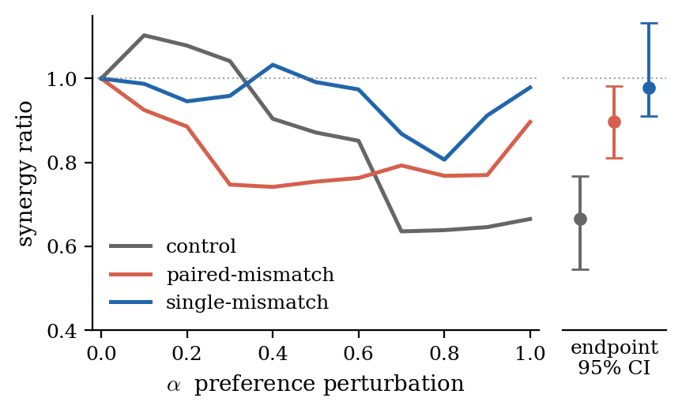

# Counterfactual Preference Perturbation

**Auditing multi-agent LLM systems from behavioural logs alone: perturb an agent's declared preferences counterfactually and watch whether the information structure of its behaviour responds.**

Dominic Behling · University of Tübingen

Accepted at the **AI Transparency Conference (AITC 2026)** for **oral presentation**; final version in press.
📄 [Paper PDF](paper/counterfactual_preference_perturbation.pdf)

<p align="center">
  
</p>

*The headline result: when an agent's behaviour was generated by its declared preferences (control), perturbing those preferences disrupts pair synergy (ratio falls to 0.67). When the agent actually played under modified preferences (mismatch), the same perturbation produces no drop. The response, not the level, of synergy carries the alignment signal.*

## What this is

In a multi-agent LLM system, an agent can satisfy its declared objective at the outcome level without that objective having been load-bearing in producing its behaviour. This repository implements **counterfactual preference perturbation**, a post-hoc auditing method whose only inputs are behavioural logs and the agents' declared preferences. It holds the logs fixed, interpolates one agent's preference sheet toward a misaligned target, and measures the response through **partial information decomposition (PID)**: if the behaviour was coupled to the declared preferences, synergy in agent pairs drops as the perturbation grows; if it was decoupled, the response is flat. This localises objective mismatch **by agent, by preference dimension, and by time window**. It requires no model access, no message content, and not a single additional LLM call.

## Key results

- **Agent-level localisation**: across 65 controlled negotiation games, the perturbation endpoint separates aligned from misaligned agents: control 0.665 [0.545, 0.768] vs. single mismatch 0.979 [0.910, 1.133] (cluster-bootstrap 95% CIs).
- **Temporal localisation**: when preferences are silently swapped mid-game, per-window analysis finds the change point: pre-swap 0.588 vs. post-swap 1.001, non-overlapping CIs.
- **Synergy is the load-bearing measure**: 81–96% of the perturbation response concentrates in the PID synergy atom; scalar alternatives (best-response gap, Nash bargaining distance, O-information) show no comparably clean response.
- **Cross-environment transfer**: the mismatch signature survives on GovSim's common-pool resource scenario (extractive outsider uniquely localised at ratio 3.68 [1.36, 5.51]), with documented substrate-dependence of the feature encoding.

## Quickstart

```bash
conda env create -f environment.yml
conda activate counterfactual-perturbation
jupyter notebook demo.ipynb
```

The demo notebook walks through the method on the included data in ~10 minutes: PID intuition on a toy example, then the actual perturbation sweep reproducing the headline result. Everything runs offline; the processed per-game features and results are included.

## Repository map

| Path | Contents | Paper |
|---|---|---|
| `deliberation/pid_numpy.py` | Williams–Beer I_min PID estimator (pure NumPy) | §3.1 |
| `deliberation/pairwise_pid.py` | feature binning + pairwise PID pipeline | §3.1 |
| `deliberation/extract_features.py` | behavioural feature encoding from game logs | §3.2 |
| `deliberation/synthetic_drift/` | perturbation sweep engine; scalar-measure comparison | §3.2, Fig. 7 |
| `deliberation/collusion/` | controlled mismatch experiment, 65 games | §4.1, Fig. 1 |
| `deliberation/ceo_update/` | mid-game preference swap (temporal localisation) | §4.1, Fig. 2 |
| `deliberation/agent_issue_scan/` | blind agent × issue scan | §4.1, Fig. 3 |
| `deliberation/multi_agent_drift/` | per-agent perturbation profiles, 6 configurations | App. A, Fig. 5 |
| `deliberation/*_sensitivity/`, `*_ablation/` | robustness: binning, source/target encodings, per-issue ablation | App. D |
| `govsim/` | GovSim cross-environment probe | §4.3, Fig. 4 |
| `paper/` | final paper PDF + regenerated figures | |
| `demo.ipynb` | guided walk-through on included data | |

Each experiment folder contains its analysis script, its processed inputs, and its results (`results/*.json`).

## Reproducing the figures

The main figures regenerate offline from the included processed data (Figs. 1-4 land in `paper/figures/`, Figs. 5 and 7 in the experiment's own `figures/` folder):

```bash
python deliberation/collusion/figure_1_agent_level.py         # Fig. 1
python deliberation/ceo_update/figure_2_temporal.py           # Fig. 2
python deliberation/agent_issue_scan/figure_3_heatmap.py      # Fig. 3
python govsim/govsim_pid/figure_4_govsim.py                   # Fig. 4
python deliberation/multi_agent_drift/multi_agent_drift.py --replot   # Fig. 5
python deliberation/synthetic_drift/comparison_drift.py       # Fig. 7
```

The deliberation analyses (perturbation sweeps + cluster bootstrap) also rerun offline from the included per-game features, e.g. `python deliberation/collusion/analyze.py`.

## Data

Included: processed per-game feature encodings and all results JSONs, sufficient to rerun the deliberation analyses and regenerate the figures above. Not included: raw negotiation transcripts and GovSim episode logs (~60 MB) and the third-party benchmark code; see [`third_party/README.md`](third_party/README.md) for pinned upstream references, and open an issue if you need the raw logs.

## Citation

The paper is in press at AITC 2026; the entry below will be updated with the published
version (DOI, pages) once it appears.

```bibtex
@inproceedings{behling2026counterfactual,
  title     = {Counterfactual Preference Perturbation Localises Objective
               Misalignment in Multi-Agent LLM Negotiation},
  author    = {Behling, Dominic},
  booktitle = {AI Transparency Conference (AITC)},
  year      = {2026},
  note      = {In press}
}
```

## License

MIT
